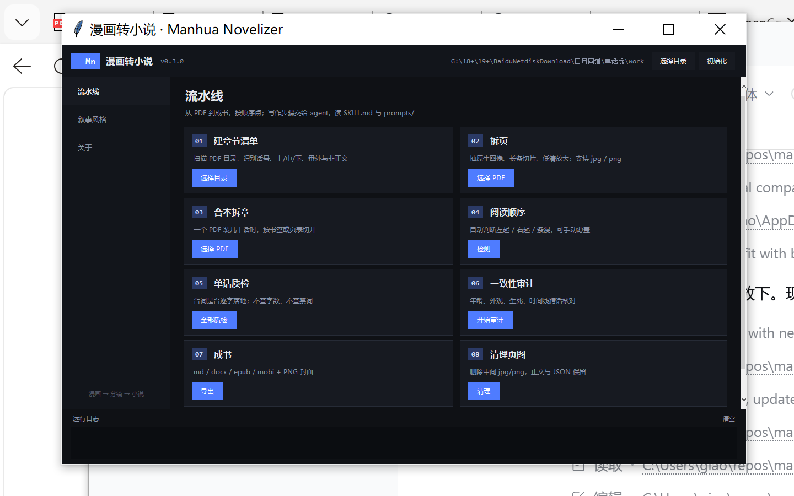

# Manhua Novelizer · 漫画转小说

把**只有图、没有文本层**的中文漫画 PDF，按原作叙事风格转成小说，并导出成书。

```
PDF 页图 ──► 页脚本 JSON ──► 章脉络(+state) ──► 正文(读 style.md) ──► 质检
             (逐格转录)       (合并成场)         (按原作风格写)      (台词/事件/忠实)
                                                                    │
                                        全本一致性审计 ◄────────────┘
                                    (年龄/建模/死亡/时间线)
```

## 这是什么

一个**小软件**，不是一堆散脚本：

- `mnv` 命令行：建清单、拆章、拆页、质检、审计、成书、清理、风格配置
- `mnv gui`：Tkinter 图形界面，同样的功能点按钮
- 写作本身交给 agent，读 `SKILL.md` 与 `prompts/`

## v0.3 的关键变化

| 变化 | 说明 |
|---|---|
| 取消字数限制 | 篇幅由事件密度决定，`qa` 不再查字数 |
| 取消禁用词表 | 不再用词表卡文本；只保留"不写分镜说明"的原则 |
| 情节优先 | 质检重心改为：台词覆盖、事件完整性、忠实度、声音一致性 |
| 叙事风格配置 | 新增前置任务：八维度风格档案，确认后才动笔，改动自动留版本 |
| 多格式 | md / docx / **epub** / **mobi**（内置写出器，无需 calibre）+ **cover.png** |
| 页图格式 | jpg 或 png；`mnv clean` 一键清理中间图（含 png） |
| 软件化 | 打包为 `manhua_novelizer` 包，`mnv` 入口 + GUI |
| 即开即用 | 可打包成**单文件 exe**，双击运行，不需要装 Python |

## 直接用 exe（推荐给非开发者）

下载 `ManhuaNovelizer.exe`，双击即可，无需安装 Python 或依赖。

```powershell
ManhuaNovelizer.exe                 # 图形界面
ManhuaNovelizer.exe --selftest      # 自检（确认打包完整）
ManhuaNovelizer.exe build --work work --out build --title "书名"
```

自己构建：

```powershell
powershell -ExecutionPolicy Bypass -File packaging\build_exe.ps1
# 产物：dist\ManhuaNovelizer.exe（约 90–150 MB，首次启动解压 3–8 秒）
```

细节与杀软误报处理见 `packaging/README.md`。

## 安装（开发者）

```bash
git clone <repo> && cd manhua-novelizer
pip install -e .
# 依赖：pymupdf, pillow；可选 python-docx（docx 导出）
```

## 快速开始

```bash
mnv init --work work
mnv manifest --dir pdf --out work/manifest.csv
mnv pages --pdf "pdf/001.pdf" --out work/ch001/pages        # 可加 --format png
mnv order --pages work/ch001/pages --work work              # 阅读顺序：ltr / rtl / ttb
mnv order --set rtl --work work                             # 检测不准时手动覆盖

# 交给 agent：先做风格配置，再逐话转录/写作
#   prompts/00-style-analysis.md → work/style.json
#   mnv style --action render && mnv style --action confirm

mnv qa --draft work/ch001/draft.md --outline work/ch001/outline.json --bible work/bible.md
mnv audit --work work --bible work/bible.md --out work/audit/consistency.md
mnv build --work work --out work/build --title "书名" --cleanup
```

## 界面

深色桌面风格：左侧导航（流水线 / 叙事风格 / 关于），中间八张步骤卡片，底部运行日志。



- 每张卡片只做一件事，跑完显示「完成」，失败显示「失败」并把原因写进日志。
- 「阅读顺序」卡片给出 `LTR/RTL/TTB` + 置信度，检测不准可一键覆盖。
- 「叙事风格」页左侧是八个维度的状态灯，右侧直接编辑 `style.json`，保存自动快照。

成书产物：

```
work/build/
├─ book.md
├─ book.docx
├─ book.epub
├─ book.mobi
├─ cover.png
├─ stats.csv
└─ index.csv
```

## 图形界面

```bash
mnv gui
```

三个区块：工作目录、流水线按钮（清单/拆页/拆章/质检/审计/成书/清理）、叙事风格配置编辑器
（载入、保存快照、确认、导出 `style.md`）。

## 中间页图清理

一册漫画拆完页，`pages/` 常有几百 MB 到几 GB。三种清法：

```bash
mnv build --cleanup                 # 成书后自动清
mnv clean --work work --dry-run     # 先看能省多少
mnv clean --work work --keep work/ch001/pages   # 保留某一话
```

只删 `.jpg/.jpeg/.png`，正文、JSON、清单、圣经都保留。

## 叙事风格配置

八个维度：叙事节奏、情绪表达、对白特征、画面转译、信息揭示、描写密度、特有表达习惯、禁止破坏的特征。

```bash
mnv style --action check     # 哪些还没填
mnv style --action render    # 生成 style.md
mnv style --action confirm   # 确认后才批量写作
```

每次保存都会把旧版快照进 `style_history/`，改风格前后可对比。

## 目录

```
manhua-novelizer/
├─ SKILL.md                     agent 主入口
├─ manhua_novelizer/            软件本体
│  ├─ cli.py  gui.py            入口
│  ├─ manifest.py  split.py  pages.py
│  ├─ qa.py  consistency.py
│  ├─ reading_order.py           阅读顺序检测
│  ├─ build.py  epub.py  mobi.py
│  ├─ style.py  config.py
├─ packaging/                    exe 打包（entry.py / build_exe.ps1 / icon）
├─ docs/screenshot.png           界面截图
├─ prompts/
│  ├─ 00-style-analysis.md      ★ 前置：风格分析
│  ├─ 01-page-script.md
│  ├─ 02-chapter-outline.md
│  ├─ 03-prose.md               ★ 重写：无字数/无禁词
│  ├─ 04-qa.md                  ★ 重写：只看忠实
│  ├─ 05-bible.md
│  ├─ 06-consistency-audit.md
│  ├─ 07-web-research.md
│  └─ 08-reading-order.md       ★ 阅读顺序确认
├─ references/
│  ├─ principles.md             ★ 改编原则（最高准则）
│  ├─ style-config.md           ★ 风格配置规范
│  ├─ pipeline.md
│  ├─ schemas.md
│  └─ research.md
├─ scripts/                     兼容旧路径的薄壳
└─ examples/
```

## 已知限制

- MOBI 写出器为最小实现（PalmDOC 无压缩、无内嵌图），Kindle/KOReader/Calibre 可读；排版不如 calibre 转换精细。
- 页脚本质量取决于页图分辨率；宽 < 700 px 建议先超分。
- `qa` 的人名检测是启发式的，仅作提示，不作失败判定。
- 忠实度与风格执行必须由 agent 抽页复核，脚本判不了。
- 不做竖排右起老式排版（港漫）；需要时给 `reading_direction: rtl` 并调整阅读顺序。

## License

MIT
